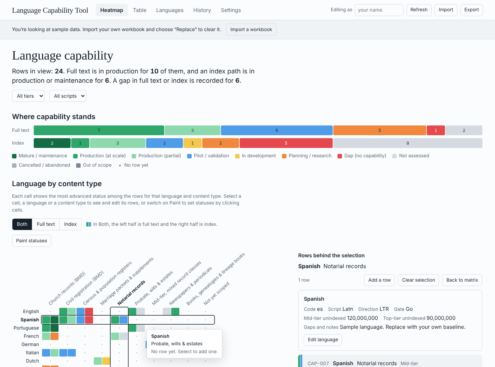

# Language Capability Tool

Track where full-text and index capability stands for every language and content type, and see it as a heatmap.
Each row is one capability cell: a language, a content type and a tier, with one status for full text and one for
index. You can set capability in the tool, by painting the heatmap, in a spreadsheet, or from the command line.



## Run it

You need Python 3.9 or newer. Nothing else is required to start; `openpyxl` adds Excel import and export.

```bash
git clone https://github.com/sam-silvester/LanguageCapabilityTool.git
cd LanguageCapabilityTool
python3 -m venv .venv
source .venv/bin/activate          # Windows: .venv\Scripts\activate
pip install -r requirements.txt    # openpyxl, for .xlsx files
python -m lct
```

Then open <http://localhost:8765>. The tool starts with a small invented sample so there is something to look at.
To load your own data, choose **Import**, pick your workbook and select **Replace**.

| Option | What it does |
| --- | --- |
| `python -m lct serve --port 9000` | Use another port. |
| `python -m lct serve --host 0.0.0.0` | Let other people on your network open it (see "Sharing with a team"). |
| `python -m lct serve --no-sample` | Start empty instead of with the sample rows. |
| `python -m lct --data path/to/file.db serve` | Keep the data somewhere else. `LCT_DATA` does the same. |

With Docker:

```bash
docker build -t language-capability-tool .
docker run -p 8765:8765 -v "$PWD/data:/data" language-capability-tool
```

## What it does

**Heatmap.** Languages down the side, content types across the top. Each cell shows the most advanced status among
its rows, split in two: full text on the left, index on the right. You can switch to full text only or index only and
filter by tier or script. Above it, two bars show how many rows sit at each status, and a sentence gives the headline
counts. Below it, a chart shows unindexed images by language.

**Five ways to set capability**

1. **Pick a cell.** Select a cell, a language or a content type. The panel lists the rows behind it, each with a
   full-text and an index dropdown that save as you change them. "Edit all fields" opens every field; "Duplicate"
   copies a row so you can split it; an empty cell offers "Add a row".
2. **Paint.** Switch on "Paint statuses", choose full text or index and a status, then click cells. A cell with rows
   gets the status on all of them; an empty cell gets a new row.
3. **Table.** The Table tab is a spreadsheet-style grid of every row. Click a cell to edit it, filter and sort, or
   show every column.
4. **Spreadsheet.** Export to Excel, edit there, import the file back. The import shows a preview of what will be
   added, changed and removed before anything is saved.
5. **Command line or API.** `python -m lct set` and `python -m lct paint` change single values; the JSON API does the
   same for scripts.

**Languages.** One row per language with its script, quality marks and volumes. Renaming a language renames it on
every capability row.

**History and undo.** Every change is recorded with who made it, when and how. Each action shows an Undo button for
a few seconds, and History can revert any earlier entry, including a whole import. A daily snapshot feeds a small
chart of rows in production and recorded gaps over time.

**Settings.** The dataset name, the prefix for new row IDs, and every dropdown list. The order of the Status list is
the ranking the heatmap uses.

## Working with spreadsheets

An Excel import reads three sheets, all optional:

| Sheet | What it holds |
| --- | --- |
| `Matrix` (or `Capabilities`) | One capability row per line. Needs `Language` and `Content type` columns. |
| `Languages` | One language per line. Needs a `Language` column. |
| `Lists` | One dropdown list per column, with the list name as the heading. |

The heading row doesn't have to be the first row, so workbooks with a title above the table import as they are.

- Rows are matched by **ID**. Leave ID empty on a new row and the tool assigns the next one.
- **Merge** updates matching rows and adds new ones. **Replace** also deletes rows that are missing from the file.
- Only the columns in the file are touched. An empty cell in one of those columns clears the field.
- A column the tool doesn't know becomes a new field, shown in the table and the edit dialog.
- Values on the `Lists` sheet replace the tool's dropdown values for those lists.
- A status that isn't on the Status list is kept, flagged in the preview and shown as "No status" until fixed.

CSV works the same way for one table at a time: capability rows by default, or languages if you say so in the import
dialog. The JSON export holds everything and imports back unchanged.

## Command line

```bash
python -m lct import workbook.xlsx              # merge
python -m lct import workbook.xlsx --replace    # make the tool match the file
python -m lct import workbook.xlsx --dry-run    # show what would change, keep nothing
python -m lct export capability.xlsx            # or .csv, .json
python -m lct set CAP-012 "Index status" "Pilot / validation"
python -m lct paint "Spanish" "Notarial records" ix "Production (partial)"
```

## API

Every route returns JSON. Routes that change data need the header `X-Requested-With: lct`; add `X-User: your name`
to sign the change in History. Changes answer with the full new state, a message and a `batch` id you can undo.

| Method and path | Purpose |
| --- | --- |
| `GET /api/state` | Rows, languages, fields, lists and settings. |
| `POST /api/capabilities` | Add a row. Body: field keys and values. |
| `PUT /api/capabilities/{id}` | Change fields on a row. |
| `DELETE /api/capabilities/{id}` | Delete a row. |
| `POST /api/paint` | Body: `language`, `content_type`, `side` (`ft` or `ix`), `status`. |
| `POST /api/languages`, `PUT /api/languages/{name}`, `DELETE /api/languages/{name}` | Manage languages. |
| `PUT /api/lists/{name}` | Replace a dropdown list. Body: `{"items": [{"name": "...", "description": "..."}]}`. |
| `PUT /api/meta` | Body: `name`, `id_prefix`. |
| `POST /api/undo` | Body: `{"batch": "..."}`. |
| `POST /api/import?filename=x.xlsx&strategy=merge&apply=1` | Body: the file itself. Leave out `apply=1` for a preview. |
| `GET /api/export?format=xlsx` | Also `csv` (add `&sheet=languages` for languages) and `json`. |
| `GET /api/changes`, `GET /api/snapshots` | History and daily counts. |

```bash
curl -X PUT http://localhost:8765/api/capabilities/CAP-012 \
  -H "Content-Type: application/json" -H "X-Requested-With: lct" -H "X-User: Ana" \
  -d '{"ix_status": "Pilot / validation"}'
```

## Your data

Everything is kept in one SQLite file, `data/lct.db`. Copy that file to back it up. The `data/` folder, `.xlsx`
workbooks and the tool's own exports are in `.gitignore`, so capability data doesn't end up in the repository by
accident. The only data in the repository is the invented sample in `lct/sample.py`.

## Sharing with a team

Run it on a machine your team can reach with `--host 0.0.0.0` and share the address. There is no sign-in: anyone who
can reach the port can edit, so keep it on a trusted network or behind your own proxy. The "Editing as" name is
whatever each person types. Two people editing the same field at once is resolved in favour of the last save; use
Refresh to pick up other people's changes.

## Tests

```bash
python -m unittest discover -s tests -v
```

## Project layout

```
lct/
  __main__.py     command line
  server.py       HTTP server and JSON API (standard library)
  store.py        SQLite store, change log, undo, paint, import
  sheets.py       .xlsx, .csv and .json in and out
  schema.py       default fields and dropdown lists
  sample.py       invented sample data
  static/         the web app (plain HTML, CSS and JavaScript; D3 is bundled)
tests/            unit tests
```

D3 is bundled under the ISC licence; see `THIRD_PARTY.md`.
